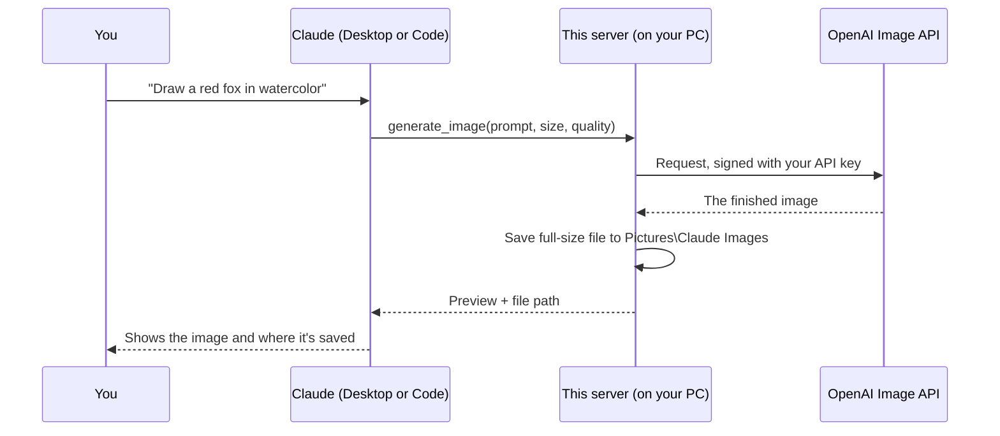

# OpenAI Image Generation for Claude

**Generate and edit images with OpenAI right inside Claude.** This free, open-source add-on lets Claude Desktop and Claude Code create pictures with OpenAI's GPT Image models (the successor to DALL·E). Ask Claude for "a watercolor fox in the snow" and the image shows up in your chat and is saved to your Pictures folder. It runs entirely on your own computer as a local MCP server and uses your own OpenAI API key, so there's no website to sign up for, nothing hosted online, and no middleman between you and OpenAI.

If you've been looking for a way to make AI images in Claude, use ChatGPT's image generator from Claude, or add text-to-image generation to Claude Code, this is it.

- [What you can do](#what-you-can-do)
- [How it works](#how-it-works)
- [What you need](#what-you-need)
- [What it costs](#what-it-costs)
- [Setup](#setup)
- [Using it](#using-it)
- [Choosing a model](#choosing-a-model)
- [Your API key](#your-api-key)
- [Other settings](#other-settings)
- [Uninstalling](#uninstalling)
- [Troubleshooting](#troubleshooting)
- [Reference](#reference)
- [Development](#development)

## What you can do

Once it's set up, you talk to Claude normally. Claude decides when to use the image tool, and asks your permission before each call.

- **Create images from a description.** "Make a landscape banner of a lighthouse at dusk, flat illustration style."
- **Iterate in conversation.** "Nice. Now make the sky more orange and add a sailboat." Claude sees each result, so it can refine the prompt for you.
- **Edit your own images.** "Take `C:\Users\me\Pictures\room.jpg` and repaint the walls sage green."
- **Combine images.** "Use these three product photos as references and make a single gift-basket shot."
- **Get transparent PNGs** for logos, icons, and stickers.
- **Pick the model.** It uses OpenAI's newest image model automatically, but you can ask for any model your account has, including older, cheaper ones.

Every image is saved at full resolution in a folder on your computer, so nothing gets lost when the chat ends.

## How it works

Claude can't make images by itself. What it can do is use *tools*: small programs that give it new abilities. The standard way to plug a tool into Claude is the **Model Context Protocol (MCP)**, and a program that offers tools this way is called an **MCP server**.

This project is an MCP server. You tell Claude Desktop and Claude Code where it is once, and from then on:



A few details that tend to come up:

- **You never start it yourself.** Each Claude app launches the server in the background when the app (or a Claude Code session) starts, and stops it when the app closes. There's nothing to run at boot and no port to open.
- **One install serves both apps.** Claude Desktop and Claude Code each get a one-line entry pointing at the same program, and a single setup command adds both.
- **It's local.** The server runs on your machine and talks to exactly one outside service: `api.openai.com`.
- **Your key stays in your system's credential store,** not in a file. See [Your API key](#your-api-key).
- **Claude sees a preview, you get the original.** The chat gets a smaller copy (768 pixels on the long edge) so the conversation stays fast. The full-resolution file is in your images folder.

## What you need

- **An OpenAI API key.** This is a developer key from [platform.openai.com](https://platform.openai.com/api-keys), billed per use. A ChatGPT Plus or Pro subscription doesn't include API access; the two are billed separately.
- **OpenAI Organization Verification.** OpenAI requires it for GPT Image models. Complete it once under your organization's settings on the OpenAI platform, or image requests may be refused.
- **Claude Desktop and/or Claude Code.**
- **[uv](https://docs.astral.sh/uv/getting-started/installation/),** a Python project tool. It installs the right Python version and this project's libraries for you.
- **Git,** to download the project.

This project is built and tested on **Windows**. The code is cross-platform and should work on macOS (Keychain) and Linux (Secret Service), but the instructions use Windows paths.

## What it costs

The server is free. OpenAI bills your account for each image it creates:

- A typical image costs a few cents to a few tens of cents, depending on the model, size, and quality. See [OpenAI's pricing page](https://openai.com/api/pricing/) for current rates.
- Older models are usually cheaper. See [Choosing a model](#choosing-a-model) to pin one.
- `quality: "low"` is the cheapest and fastest; `"max"` is the most expensive.
- Asking for several images at once (`n`) bills each one.

Set a monthly spending limit on your OpenAI project so a long creative session can't surprise you.

## Setup

This takes about five minutes. Run the commands in PowerShell or Windows Terminal.

### 1. Download the project

Pick a permanent home for it, because both Claude apps will point at this folder.

```powershell
cd $HOME\Documents
git clone https://github.com/rogadev/openai-image-mcp.git
cd openai-image-mcp
uv sync
```

### 2. Run setup

```powershell
uv run manage.py setup
```

Setup does three things:

1. **Asks for your API key.** Paste it at the prompt; it stays hidden, and setup tells you how many characters it received. If Ctrl+V does nothing (common in the older Windows PowerShell window), right-click to paste. Setup asks OpenAI whether the key works before saving it, then stores it in Windows Credential Manager.
2. **Adds the server to Claude Code** for all your projects, if Claude Code is installed.
3. **Adds the server to Claude Desktop,** if it finds Claude Desktop's config file. It backs up the file first, as `claude_desktop_config.json.bak-openai-image-mcp`.

Then quit Claude Desktop completely (right-click its icon in the system tray and choose **Quit**; closing the window isn't enough) and open it again.

> Don't save your key in a text file to paste from later. Copy it straight from the OpenAI dashboard into the setup prompt.

### 3. Check and try it

```powershell
uv run manage.py check
```

This shows whether a key is stored and accepted by OpenAI, which model is the default, and whether each app is set up. Then:

- **Claude Code:** start a new session (a session that was already open won't see the new tool) and ask: *"Generate a low-quality 1024x1024 image of a lighthouse at dusk."*
- **Claude Desktop:** in the message box, select **+**, then **Connectors**, and check that `openai-images` is listed. Then ask for the same image.

Approve the tool when Claude asks. After 10 to 60 seconds the image is saved in `Pictures\Claude Images`. See [Viewing your images](#viewing-your-images) for how it shows up in each app.

<details>
<summary>Setting up by hand instead</summary>

**Claude Code:**

```powershell
claude mcp add --scope user --transport stdio openai-images -- "C:\path\to\openai-image-mcp\.venv\Scripts\openai-image-mcp.exe"
```

**Claude Desktop:** open **Settings**, then **Developer**, then **Edit Config**, and add this inside the file's top-level braces, keeping any settings already there. Use double backslashes:

```json
"mcpServers": {
  "openai-images": {
    "command": "C:\\path\\to\\openai-image-mcp\\.venv\\Scripts\\openai-image-mcp.exe",
    "args": []
  }
}
```

**Key:** `uv run manage.py key`.

</details>

## Using it

Just describe what you want. Claude chooses the options, but you can steer them in plain language:

| Say something like | What Claude sets |
|---|---|
| "quick draft", "rough version" | `quality: "low"` |
| "highest quality", "final version" | `quality: "high"` or `"max"` |
| "landscape", "16:9 banner" | `size: "1536x1024"`, or a custom size such as `"1920x1080"` |
| "portrait", "phone wallpaper" | `size: "1024x1536"` |
| "transparent background", "logo", "sticker" | `background: "transparent"` with PNG |
| "give me three options" | `n: 3` |
| "use gpt-image-2.5-flare for this one" | `model` for that request only |

Prompting tips:

- **Be specific** about subject, style, lighting, composition, and colors. "A close-up photo of a ceramic mug on a wooden desk, morning light, shallow depth of field" beats "a mug".
- **Put text in quotes** if you want it rendered in the image: *a poster that says "Grand Opening"*.
- **For edits, give the full file path** and say exactly what should change and what should stay the same.
- **Iterate.** Claude sees each result, so "warmer colors" or "zoom out a bit" works well.

### Viewing your images

- **Claude Desktop** shows the image right in the conversation, inside the tool's result.
- **Claude Code** runs in a terminal, which can't display pictures. Claude still sees the image (so it can describe or refine it), and its reply includes a link for each file, such as `file:///C:/Users/you/Pictures/Claude%20Images/2026-11-15_143205_a-red-fox.png`. In Windows Terminal, Ctrl+click the link to open the image in your default viewer. You can also say **"and open it"** in your request, and the server opens each new image for you as soon as it's saved.
- **Either app:** every image is in `Pictures\Claude Images`, and the reply includes a link to that folder too.

## Choosing a model

**By default, the server always uses OpenAI's newest image model.** Each time it needs a model, it checks which image models your key can use (once an hour at most) and picks the newest one. When OpenAI releases a new model, you get it automatically, with nothing to update. Among variants of the newest version, it prefers the fast everyday one (for example, Flare over Sunburst).

You can change that any time.

| You want to | Ask Claude | Or run |
|---|---|---|
| See the models your key can use | "Which image models can I use?" | `uv run manage.py models` |
| Search them | "Show me the 2.5 image models" | `uv run manage.py models 2.5` |
| Use a model for one image only | "Make this one with gpt-image-2.6-sunburst" | |
| Pin one as your default | | `uv run manage.py model gpt-image-2.5-flare` |
| Go back to the newest | | `uv run manage.py model latest` |

A few things worth knowing:

- **Only you can change the saved default.** Claude can list models and use any of them for a single image, but changing the default is a command you run yourself. That way nothing Claude reads (a web page, a document) can quietly switch you to a different or pricier model for every future image.
- **Pinning is a choice, not a lock-in.** A pinned model stays your default until you change it, even after newer models come out.
- **Dated IDs are fixed snapshots.** An ID such as `gpt-image-2-2026-04-01` never changes behavior; a plain ID such as `gpt-image-2.6-flare` may get quiet improvements from OpenAI.
- **Older models may not support every option.** The server only sends the options you ask for, so the defaults work with any model. If you ask an old model for something it can't do (for example, a transparent background), OpenAI says so and Claude passes the message on.
- **Your choice is saved** in `%APPDATA%\openai-image-mcp\settings.json` and shared by Claude Code and Claude Desktop.

## Your API key

### Where it's kept

Your key is stored in **Windows Credential Manager** under the name `openai-image-mcp`, encrypted with your Windows login. It isn't written to any file in this project or in the Claude apps' config. You can see it in **Control Panel**, then **Credential Manager**, then **Windows Credentials**.

The server reads the key from there at the moment it sends a request, and sends it only to `https://api.openai.com/v1`. That address is built into the code, so no setting (such as an `OPENAI_BASE_URL` environment variable) can redirect the key somewhere else. The key never appears in the chat. Anything running as your Windows user could also read it, which is true of any key stored on your computer, so keep the usual protections (an up-to-date system, no untrusted programs).

### Replacing an expired or revoked key

Keys get revoked, rotated, or expire. When that happens, Claude tells you "OpenAI rejected the stored API key". To fix it:

```powershell
uv run manage.py key
```

Paste the new key. It's checked with OpenAI, then **replaces** the old one; no copy of the old key is kept. The new key works on the very next request. There's no need to restart Claude.

To check the stored key at any time:

```powershell
uv run manage.py check
```

### Removing it

```powershell
uv run manage.py remove-key
```

The server keeps working but asks for a key the next time you request an image.

### Good habits

- Create a **dedicated, project-scoped key** for this tool, and set a **monthly spending limit** on that project.
- **Don't keep the key in a text file.** Paste it straight from the OpenAI dashboard into `manage.py key`.
- If a key may have leaked, **revoke it** in the OpenAI dashboard first, then store a new one.

### Using an environment variable instead

If no key is stored in Credential Manager, the server uses the `OPENAI_API_KEY` environment variable. This is handy on a machine without a credential store, but less private: every program you run can see environment variables.

## Other settings

Both settings are optional environment variables, set in the server's entry in each app.

| Variable | Default | What it does |
|---|---|---|
| `IMAGE_OUTPUT_DIR` | `Pictures\Claude Images` in your user folder | Where images are saved. The folder is created if needed. |
| `IMAGE_MODEL` | not set | Forces a model for that app, overriding the saved default. `latest` works here too. |

**Claude Code:**

```powershell
claude mcp remove openai-images -s user
claude mcp add --scope user --transport stdio --env IMAGE_OUTPUT_DIR=D:\Art\AI openai-images -- "C:\path\to\openai-image-mcp\.venv\Scripts\openai-image-mcp.exe"
```

**Claude Desktop:** add an `env` block to the entry, then restart the app. Running `manage.py setup` again keeps it.

```json
"openai-images": {
  "command": "C:\\path\\to\\openai-image-mcp\\.venv\\Scripts\\openai-image-mcp.exe",
  "args": [],
  "env": { "IMAGE_OUTPUT_DIR": "D:\\Art\\AI" }
}
```

Files are named `<date>_<time>_<first words of the prompt>.<format>`, for example `2026-11-15_143205_a-red-fox-in-watercolor.png`. Existing files are never overwritten.

## Uninstalling

```powershell
uv run manage.py uninstall
```

This removes everything the tool added outside its own folder:

- the server entry in Claude Code
- the server entry in Claude Desktop's config (after backing up the file)
- your API key from Credential Manager, including any older copies
- your saved model choice

It leaves your generated images where they are. To finish, quit Claude Desktop, close Claude Code sessions, and delete the `openai-image-mcp` folder. Add `--keep-key` if you're reinstalling and want to keep the key.

Uninstalling doesn't revoke the key with OpenAI. If you won't use it again, delete it in the OpenAI dashboard too.

## Troubleshooting

**Claude says the tool isn't available, or it doesn't appear.**
Run `uv run manage.py check`. For Claude Desktop, fully quit from the system tray and reopen it after any change. For Claude Code, start a new session, then run `/mcp`; if the server shows as failed, select it and choose **Reconnect**.

**"No OpenAI API key is stored."**
Run `uv run manage.py key`. No restart needed.

**"OpenAI rejected the stored API key."**
The key expired, was revoked, or was mistyped. See [Replacing an expired or revoked key](#replacing-an-expired-or-revoked-key).

**"The key works, but it can't use" a model.**
Complete Organization Verification on the OpenAI platform, or check that the key's project allows image models. Run `uv run manage.py models` to see what the key can use.

**OpenAI refuses a prompt.**
That's OpenAI's safety system. The message is passed back to Claude, which can explain it or suggest a rewording.

**It takes a long time.**
Complex, high-quality, or large images can take up to two minutes. Use low quality for drafts. In Claude Code, a call that runs past two minutes moves to a background task and finishes there.

**`uv sync` fails with "the process cannot access the file".**
A running Claude app is using the server. Quit Claude Desktop and close Claude Code sessions, run `uv sync`, then reopen them.

**Where are the logs?**
Claude Desktop writes this server's output to `mcp-server-openai-images.log` in its `logs` folder, next to `claude_desktop_config.json`. In Claude Code, run `claude --debug` to see MCP startup messages.

## Reference

### `manage.py` commands

Run each as `uv run manage.py <command>` in the project folder.

| Command | What it does |
|---|---|
| `setup` | Stores your key (if none is stored) and adds the server to both apps. Safe to run again. |
| `key` | Adds or replaces your API key, after checking it with OpenAI. `--no-check` skips the check. |
| `check` | Tests the stored key and shows the default model and which apps are set up. |
| `models [words]` | Lists the image models your key can use, newest first, optionally filtered. |
| `model <id>` | Sets your default model: an exact ID to pin it, or `latest`. |
| `register` | Adds the server to both apps without touching the key. |
| `remove-key` | Deletes the stored key. |
| `uninstall` | Removes the server from both apps, and deletes the key and settings. `--keep-key` keeps the key. |

### Tools Claude can use

#### `generate_image`

Creates images from a text prompt.

| Parameter | Type | Default | Notes |
|---|---|---|---|
| `prompt` | string | required | What to draw. |
| `size` | string | `"auto"` | `"auto"` or `WIDTHxHEIGHT`. Both edges must be multiples of 16, no edge over 3840, aspect ratio between 1:3 and 3:1, and 655,360 to 8,294,400 pixels in total. Common sizes: `1024x1024`, `1536x1024`, `1024x1536`. |
| `quality` | string | `"auto"` | `"low"`, `"medium"`, `"high"`, `"xhigh"`, `"max"`, or `"auto"`. |
| `background` | string | `"auto"` | `"transparent"`, `"opaque"`, or `"auto"`. Transparent needs PNG or WebP. |
| `output_format` | string | `"png"` | `"png"`, `"jpeg"`, or `"webp"`. |
| `n` | integer | `1` | 1 to 4 images. Each is billed. |
| `model` | string | your default | A model ID for this request only. |
| `open_after` | boolean | `false` | Open each saved image in your default image viewer. |

#### `edit_image`

Edits local images, or combines several as references. Takes the same options as `generate_image`, plus:

| Parameter | Type | Notes |
|---|---|---|
| `image_paths` | list of strings | Full paths to one or more local PNG, JPEG, or WebP files, each up to 50 MB. |
| `mask_path` | string, optional | A PNG the same size as the first image. Its transparent areas mark where to edit. |

Because this tool uploads files to OpenAI, it checks every file before sending it: the extension must be `.png`, `.jpg`, `.jpeg`, or `.webp`, the file must actually open as that kind of image, and it must be 50 MB or less. Anything else (a document, a key file, a renamed file) is refused and never leaves your computer.

#### `list_image_models`

Lists the image models your key can use, newest first, marking the newest and your current default. Takes an optional `query` to filter by, such as `"2.5"` or `"flare"`.

#### What an image call returns

A text block with the model used and, for each saved file, its full path and a clickable `file:///` link, plus a link to the folder. Then one JPEG preview per image. If something goes wrong (a bad size, a missing or rejected key, an OpenAI error), the tool returns a readable error instead, and Claude can explain it or retry.

## Development

```text
src/openai_image_mcp/
  server.py   MCP server and its three tools
  images.py   OpenAI image calls, validation, file naming, previews
  models.py   Image model discovery, "latest" selection, saved default
  key.py      Stores, checks, and removes the API key
  apps.py     Adds and removes the server in Claude Code and Claude Desktop
  admin.py    The manage.py commands
manage.py     Command-line entry point
tests/        pytest suite (never calls OpenAI or touches your real key or settings)
```

Built with the [MCP Python SDK](https://github.com/modelcontextprotocol/python-sdk) (v2), the [OpenAI Python SDK](https://github.com/openai/openai-python), [keyring](https://github.com/jaraco/keyring), and [Pillow](https://python-pillow.org).

```powershell
uv sync
uv run pytest
```

To try the server without either Claude app, use the MCP Inspector:

```powershell
npx @modelcontextprotocol/inspector .venv\Scripts\openai-image-mcp.exe
```

### Branches and releases

Work happens on `dev`. Changes reach `main` only through a pull request from `dev`, merged with a merge commit once CI is green.

- **CI** (`.github/workflows/ci.yml`) runs the tests on Windows for every pull request into `main` and every push to `dev`, and fails a pull request into `main` that doesn't come from `dev`.
- **Release** (`.github/workflows/release.yml`) runs on every merge to `main`. It re-runs the tests, picks the next version from the commits since the last `vX.Y.Z` tag, and publishes a GitHub release with grouped notes.

| Change | How to get it |
|---|---|
| Patch (`1.2.3` to `1.2.4`) | The default: `fix:`, `docs:`, `chore:`, and any other commits. |
| Minor (`1.2.3` to `1.3.0`) | At least one `feat:` commit since the last release. |
| Major (`1.2.3` to `2.0.0`) | Add the `release:major` label to the `dev`-to-`main` pull request before merging. Nothing else bumps major, including a `!` or `BREAKING CHANGE` in a commit. |

The tag is the version of record, so `pyproject.toml` keeps its seed version and nothing is committed back to `main`. A failed release can be re-run from the Actions tab; a commit that's already tagged publishes nothing.
